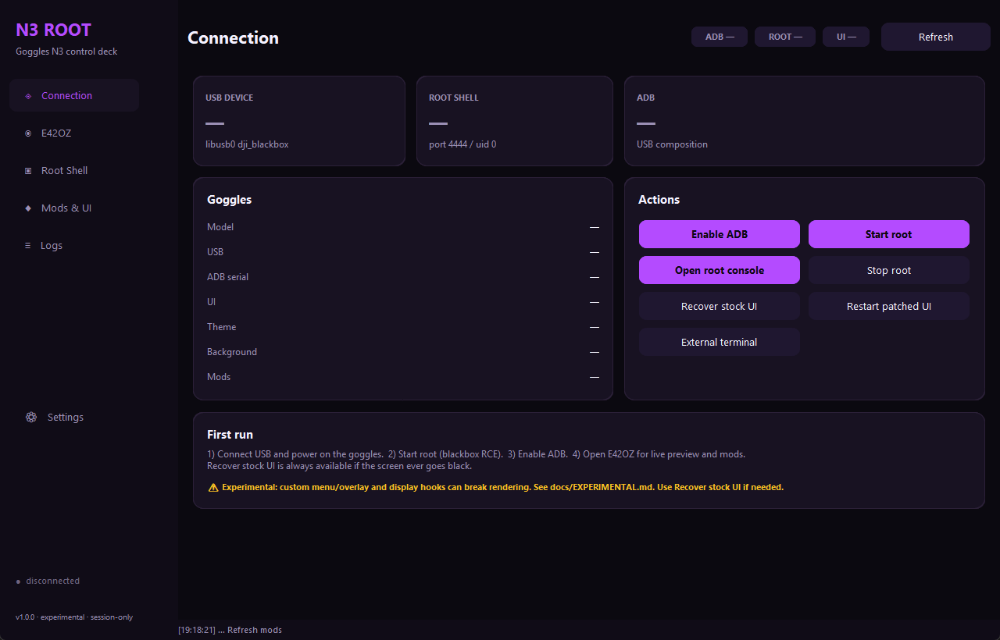

# N3 ROOT — DJI Goggles N3 control deck

A Windows desktop app for **your own** DJI Goggles N3: a session-only root
shell, ADB, a modern UI control deck, purple theme patches, custom background,
in-goggles menu apps, a live USB debug preview, and an in-goggles app SDK.



> **Private repository.** Keep it private. It contains root/exploit research and
> device-specific notes. Do not publish tokens, DJI binaries, or personal data.
> Unauthenticated access to the repo, release, and asset returns 404.

> ## ⚠️ Experimental software
>
> The **custom menu/overlay** and **display-engine hooks** can break rendering.
> A previous `displayFrame` hook build **black-screened** on 2026-11-25; those
> hooks are now compile-time **off**. If the screen ever goes black:
> **Connection → Recover stock UI**, or power-cycle the goggles.
>
> Read **[docs/EXPERIMENTAL.md](docs/EXPERIMENTAL.md)** before using the menu
> mod or enabling any experimental hook.

> **Session-only and reversible.** Nothing is written to `/system`, dm-verity is
> not touched, and OTP/RPMB/bootloader are never used. A reboot restores the
> stock UI. The app has a one-click **Recover stock UI** escape hatch.

---

## What it does

- **Connection page** — live USB / root shell / ADB status, with buttons to
  enable ADB, start/stop the root shell, restart the patched UI, or recover the
  stock UI.
- **E42OZ page** — the goggles side: a **live preview** of the UI over USB
  (160×90, ~57 fps), full-resolution screenshots, GIF recording, and quick
  actions for theme/background/menu.
- **Sparrow2 page** — read-only radio research panel. Shows the firmware
  inventory and the shipped Sparrow2 console/test tools, and can send the
  read-only `sdr_shell help` query. It explains why the console is a
  **factory-PC** tool (`test:7` host, `-1002`/`-1007`) instead of pretending it
  works, and it records that the AP-side channels are logs/dumps only — no IQ.
  No writes, no factory mode, no IQ claim. Details in
  [`docs/SPARROW2.md`](docs/SPARROW2.md) and
  [`docs/RADIO-PROBE.md`](docs/RADIO-PROBE.md).
- **Root Shell page** — an embedded console. Type commands, see output, keep
  history. Runs as uid 0 in `dji_services`.
- **Mods & UI page** — install/remove `/vendor` mods, apply purple or
  menu-only themes, set a custom background, launch the custom menu app, or
  revert everything.
- **Logs page** — tail `natartos.log`, `n3mods.log`, `dji_glasses.log`, and the
  text-tint log.
- **Settings** — paths, auto-refresh, restore-on-exit, app version.

The app is the single control point for N3 work. New mods/tools are added to
`app/plugins/` or `app/tools/` and appear in the app.

---

## Safety

This project is for **your own goggles**, on your bench.

- No `/system` writes, no dm-verity/partition changes.
- No OTP, RPMB, fuse, bootloader, or SPI/NVRAM writes.
- The root shell is the stock `dji_blackbox` log-export RCE; it is
  **session-only** and removed by `Stop root` or a reboot.
- `/vendor` is remounted read-write only while pushing theme/mod files, then
  set back to read-only.
- **Recover stock UI** always restarts `dji_glasses` even if a mod breaks the
  screen.
- The live preview and debug hooks are **read-only**; the menu app never
  suppresses real display frames.

Do not use this to intercept third-party radio traffic, decrypt firmware, or
transmit/jam. Follow local law. See [`docs/SAFETY.md`](docs/SAFETY.md).

---

## Requirements

- Windows 10/11 x64.
- Python **3.12**.
- `pip install -r requirements.txt` (CustomTkinter, Pillow).
- Android **platform-tools** (`adb.exe`) in `PATH` or `C:\platform-tools`.
- **libusb0** driver bound to the goggles' blackbox interface (use Zadig,
  WinUSB/libusb0). This is what the root-shell transport uses.
- Your goggles, a data USB cable, and the O4 air unit powered if you want a live
  camera link (the UI itself works without one).

The Linux/macOS app can use an already-enabled ADB connection; the
`dji_blackbox` root-shell step is Windows-only in this release. A small
ADB-based backup/recovery CLI is in [`linux/`](linux/).

---

## Install and run

```powershell
git clone <your-repo-url> N3-ROOT
cd N3-ROOT
py -3.12 -m pip install -r requirements.txt
powershell -ExecutionPolicy Bypass -File run.ps1
```

Or double-click **`Start N3 ROOT.cmd`**, or:

```powershell
py -3.12 app\main.py
```

### First run

1. Connect the goggles by USB and power them on.
2. Open **Connection** → **Start root** (the blackbox RCE listens on
   `192.168.60.2:4444`).
3. **Enable ADB** if you want the live preview / screenshots / file pulls.
4. Open **E42OZ** → **Start live** for the live UI preview.
5. Use **Mods & UI** for theme, background, and the custom menu.

### Recover from a black screen

```powershell
py -3.12 app\main.py
```

Then **Connection → Recover stock UI**, or from a terminal:

```powershell
py -3.12 -c "import sys; sys.path.insert(0,'app'); import n3ctl; n3ctl.start_stock_ui()"
```

A power cycle also restores the stock UI, because nothing is installed in the
boot chain.

---

## How the root shell works (short version)

The goggles ship a stock `dji_blackbox` USB log-export path. Its protocol can be
driven from the PC to spawn a shell in the `dji_services` SELinux domain
(uid 0). The app opens that shell, uses it for `/vendor` file pushes and UI
restarts, and closes it on **Stop root**. ADB is enabled by switching the USB
composition with the stock `usb_adb.sh` script.

Detailed write-ups, evidence, and reproduction notes:

- [`docs/ROOT-EXPLOIT.md`](docs/ROOT-EXPLOIT.md)
- [`docs/REPRODUCE.md`](docs/REPRODUCE.md)
- [`docs/ADB-ROOT.md`](docs/ADB-ROOT.md)
- [`docs/SELINUX.md`](docs/SELINUX.md)

No firmware is decrypted, no keys/OTP are touched, and no boot persistence is
installed.

---

## Live preview (why it is faster than other tools)


The app loads `n3live.so`, which reads the live 1920×1080 dmabuf, downscales it
by 12, and writes framed pixels to a FIFO. The PC reads that FIFO over
`adb exec-out`. Result: **160×90 at ~57 fps**.

For comparison, Toolya's own UI mirror is ~2–3 fps (full 8 MB frames). The
60 fps video seen elsewhere is the camera/live-view H.264 feed, not the goggles
UI. See [`docs/LIVE-STREAM.md`](docs/LIVE-STREAM.md).

Screenshots use a separate thread-only dmabuf capture hook; no display detour,
no frame suppression.

---

## Stability

See **[docs/EXPERIMENTAL.md](docs/EXPERIMENTAL.md)** for the full table.

| Area | Status |
|---|---|
| Control deck, live preview, screenshots, root/ADB | **Stable** |
| Themes / background | **Low risk**, reversible |
| **N3 Menu app** | **Experimental/beta** — a prior build black-screened; display hooks disabled in this build |
| Experimental `DisplayEngine` hooks | **Off — do not enable yet** |
| Legacy G3 menu/popen/template mods | **Removed** (unsafe on N3) |

## Mods and the in-goggles SDK

- `mods/n3menu` — custom in-goggles menu (window composited into the live
  buffer, key/touch suppression, long-press OK/exit). **Experimental/beta.**
- `mods/n3live` — live preview source.
- `mods/capture` — safe screenshots.
- `mods/paint` — minimal overlay proof.
- `sdk/` — `n3app.h` / `n3app.c`, a template, and `build.ps1`. See
  [`sdk/README.md`](sdk/README.md) and [`docs/OVERLAY-SDK.md`](docs/OVERLAY-SDK.md).

The menu build in this repo has the experimental `DisplayEngine` hooks
**disabled** (they caused a black screen on 2026-11-25). The safe path is the
thread compositor plus input suppression; the display hook is opt-in in source.

---

## Repository layout

```
app/            Windows control deck (CustomTkinter) + n3ctl + mods/theme modules
app/plugins/    mods discovered by the app (n3menu, n3live, capture, paint)
app/tools/      runtime root-shell + USB + debug scripts
exploit/        root-shell / blackbox transport scripts (reference copies)
sdk/            in-goggles app SDK (header, framework, template, build)
mods/           mod sources and built .so files
docs/           exploit, safety, live stream, SDK, architecture notes
linux/          ADB-based backup/recovery CLI for Linux
tests/          host tests / probes
```

Local-only (not committed, see `.gitignore`):
`app/assets/libew_gls_stock.so`, `app/assets/dji_glasses_vendor`,
`app/state/`, recordings. Put your own stock lib and vendor loader there to
build themes; they are extracted from your device/firmware and not
redistributed.

---

## Credits and licensing

- The in-goggles mod framework is derived from **natartos** (AGPL-3.0). The
  natartos-derived header/mods keep that license; see
  [`THIRD-PARTY-NOTICES.md`](THIRD-PARTY-NOTICES.md) and
  [`LICENSE`](LICENSE).
- Thanks to the DJI FPV/open-source community (natartos, toolya, fpv-wtf,
  dji-firmware-tools) for public research and tooling.
- DJI, Goggles, and O4 are trademarks of DJI. This is an independent project,
  not affiliated with or endorsed by DJI.
- Original app code in this repo is MIT-licensed. DJI binaries are **not**
  included.

**Use only on hardware you own. No warranty.**
