# N3 ROOT — DJI Goggles N3 control deck

<p align="center">
  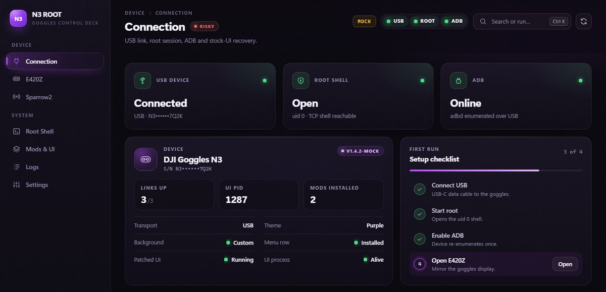
</p>

<p align="center">
  <a href="https://github.com/E420Z/DJI-GOGGLE-N3-ADB-ROOT-SHELL-APP/releases/latest"></a>
  
  
  
</p>

A Windows desktop app for **your own** DJI Goggles N3: a session-only root
shell, ADB, a modern control deck, theme and background patches, a native
in-goggles **E420Z** panel, **1080p60 goggles → PC video out**, a live USB
debug preview, and an in-goggles app SDK.

Built and tested against firmware **0900** only. Other firmware builds are
untested: the root payload, menu/vtable addresses, USB composition,
`dji_glasses` internals and the vendor OMX components are build-specific.

> [!WARNING]
> **Never write to `/system`.** The goggles run dm-verity mode 2
> (`restart_on_corruption`). A `/system` write without a full hash-tree
> recalculation bricks the device on the next reboot, and there is **no known
> unbrick path**. This project writes only `/vendor` and `/data/local/tmp`.
> Read [`docs/SAFETY.md`](docs/SAFETY.md) first.

> [!IMPORTANT]
> **Experimental software.** The E420Z menu row/panel, PC Stream, Goggles Stream
> and all display/input hooks are experimental and can leave the UI in a bad
> state. **Connection → Recover stock UI** (or a power cycle) always restores
> stock, because nothing is installed in the boot chain.

> [!NOTE]
> **Session-only.** The root shell is the stock `dji_blackbox` RCE and is removed
> by **Stop root** or a reboot. `/vendor` is remounted read-write only for a
> push, then set back to read-only.

---

## Support the project

N3 ROOT is open source. Donations go straight back into hardware, testing and
late-night debugging.

| | Address |
|---|---|
| **Bitcoin (BTC)** | `bc1qrs9rdj9rklllyp624hlkd6n0v347nsvaae4sa0` |
| **Ethereum (ETH)** | `0x49d006ff56d4848d2D21F161abDE80BD09210e74` |

Always double-check the address before sending — crypto transfers are
irreversible.

---

## What it does

| Page | What it does |
|---|---|
| **Connection** | Live USB / root shell / ADB state, first-run checklist, ADB enable, UI restart and stock-UI recovery. |
| **E420Z** | Goggles-side live preview (160×90 … 1920×1080), full-resolution screenshots, GIF recording and quick theme/menu actions. |
| **PC Stream** | Sends this desktop **into** the goggles over USB (JPEG injection). ~12 fps at 1280×720, ~5 fps at 1080p; frames drop to the newest to keep latency low. |
| **Goggles Stream** | The opposite direction: the goggles' own **1080p60 H.264** encoder, played on the PC with no re-encode. Telemetry rail and fullscreen. |
| **Sparrow2** | Read-only radio research: firmware inventory, shipped console/test tools, and the documented limits. No transmit, no IQ. |
| **Root Shell** | Embedded uid 0 console in `dji_services`, with `/system` writes blocked. |
| **Mods & UI** | Install/remove `/vendor` mods, themes, custom background, menu apps, and full revert. |
| **Logs** | Tail NATARTOS / N3MODS / UI / CAPTURE / WEB logs. |
| **Settings** | Preferences, accent, motion, density, theme picker, safety key and app version. |

**Highlights**

- **Goggles → PC:** 1920×1080 at 59–60 fps, H.264 straight from the vc8000e
  encoder, no transcode. The vendor pipe caps it at **10 Mbps**.
- **PC → goggles:** the shipped path is JPEG; a validated **H.264 + hardware
  decoder** path is in development (see
  [`docs/PC-STREAM.md`](docs/PC-STREAM.md)).
- **Native E420Z panel:** a real row in the stock sidebar, no stock row replaced,
  runtime `/vendor` mod only.
- **In-goggles SDK:** build freestanding `.so` apps with the natartos-style
  loader contract ([`sdk/`](sdk/)).

---

## Screenshots

### Control deck

<table>
<tr>
<td align="center" width="33%">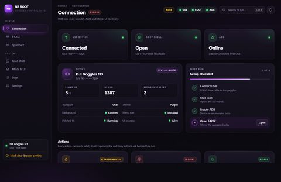<br><sub><b>Connection</b> — USB, root shell, ADB, recovery</sub></td>
<td align="center" width="33%">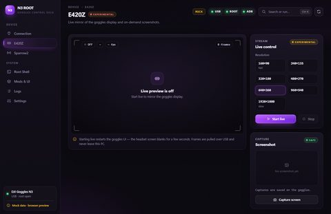<br><sub><b>E420Z</b> — live preview, scales, screenshots</sub></td>
<td align="center" width="33%">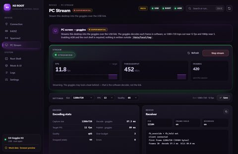<br><sub><b>PC Stream</b> — desktop → goggles</sub></td>
</tr>
<tr>
<td align="center" width="33%">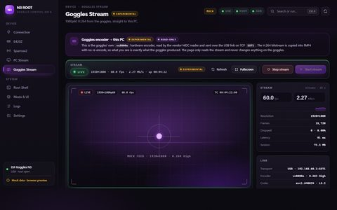<br><sub><b>Goggles Stream</b> — 1080p60 → PC</sub></td>
<td align="center" width="33%">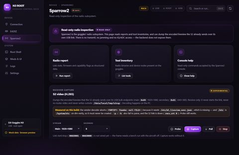<br><sub><b>Sparrow2</b> — read-only radio research</sub></td>
<td align="center" width="33%">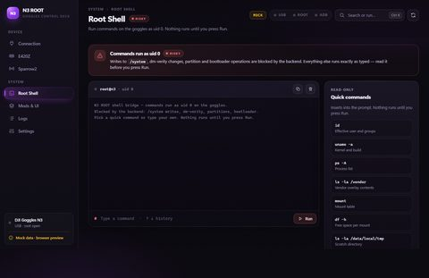<br><sub><b>Root Shell</b> — uid 0 console</sub></td>
</tr>
<tr>
<td align="center" width="33%">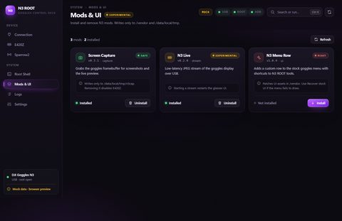<br><sub><b>Mods &amp; UI</b> — install, themes, revert</sub></td>
<td align="center" width="33%">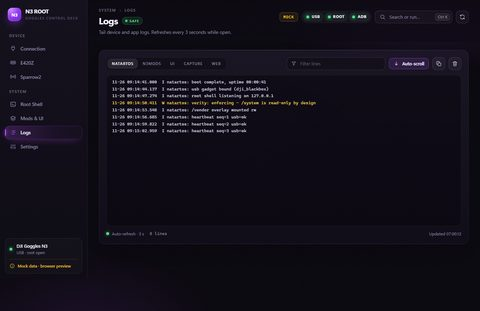<br><sub><b>Logs</b> — five live tabs</sub></td>
<td align="center" width="33%">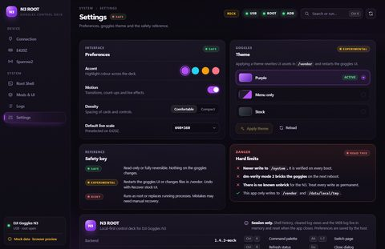<br><sub><b>Settings</b> — prefs, theme, safety key</sub></td>
</tr>
</table>

### Native E420Z panel

<table>
<tr>
<td align="center" width="33%">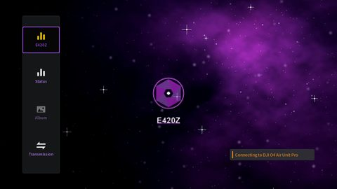<br><sub><b>Sidebar</b> — native E420Z row</sub></td>
<td align="center" width="33%">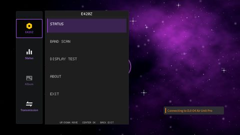<br><sub><b>Panel</b> — stock-styled content area</sub></td>
<td align="center" width="33%">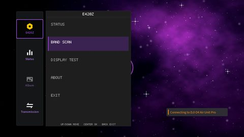<br><sub><b>List</b> — BAND SCAN selected</sub></td>
</tr>
<tr>
<td align="center" width="33%">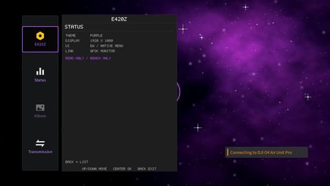<br><sub><b>STATUS</b> — read-only detail</sub></td>
<td align="center" width="33%">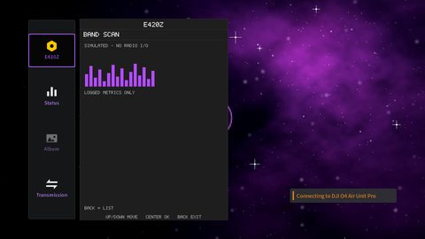<br><sub><b>BAND SCAN</b> — simulated, read-only</sub></td>
<td align="center" width="33%"></td>
</tr>
</table>

### Legacy fallback

<p align="center">
  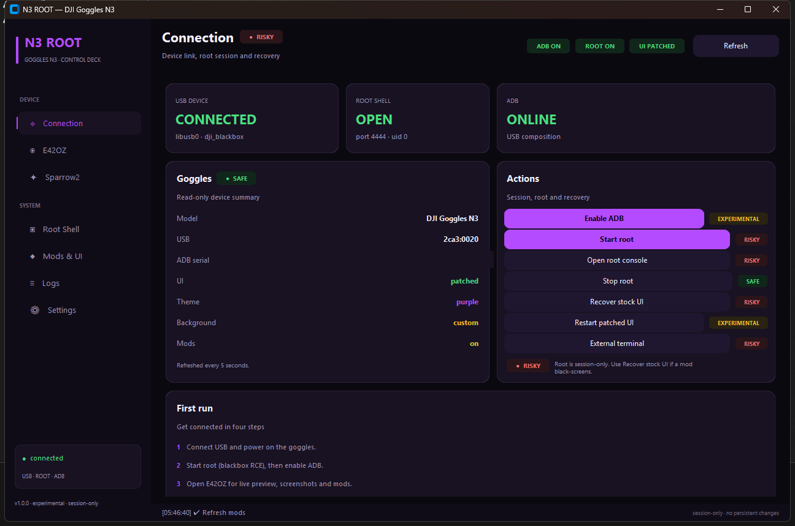<br>
  <sub><b>Classic Tk</b> — automatic fallback if pywebview or the web files are missing</sub>
</p>

### Hardware

<p align="center">
  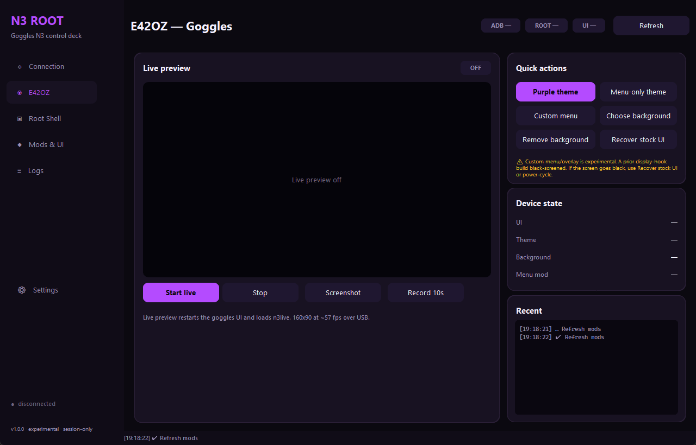
</p>

More captures and reproduction notes:
[`docs/screenshots/README.md`](docs/screenshots/README.md).

---

## Requirements

### Hardware

- **DJI Goggles N3**, firmware **0900** (the only version tested).
- A USB-C **data** cable — charge-only cables will not enumerate.
- Optional: the O4 air unit / aircraft powered on for a live camera link. The UI,
  root shell, PC Stream and Goggles Stream all work without one.

### PC

- **Windows 10/11 x64.**
- **Python 3.12.**
- Python packages: `py -3.12 -m pip install -r requirements.txt`
  (`pywebview`, `Pillow`, and `customtkinter` for the Tk fallback).
- **Microsoft Edge WebView2 runtime** — preinstalled on Windows 11 and most
  Windows 10 installs; install the Evergreen runtime if the window is blank.
- **libusb0 driver** bound to the goggles' blackbox interface (Zadig →
  WinUSB/libusb0). This is the root-shell transport.
- **Android platform-tools** (`adb.exe`) in `PATH` or `C:\platform-tools` for
  ADB, live preview, screenshots, file pulls and PC Stream.
- **ffmpeg** in `PATH`, `tools\ffmpeg.exe`, or via `FFMPEG=...` for the
  **Goggles Stream** page.

### Per feature

| Feature | Also needs |
|---|---|
| Control deck UI | WebView2 runtime (falls back to the Tk app) |
| Root shell | libusb0 driver on the goggles |
| ADB / files / logs | `adb.exe` from platform-tools |
| E420Z live preview + screenshots | ADB, plus the `n3live` mod from Mods & UI |
| PC Stream (desktop → goggles) | ADB **and** the root shell, plus the **Frame injection (PC stream)** mod |
| Goggles Stream (goggles → PC) | the root shell, the **video-out** mod, and **ffmpeg** on the PC |
| Themes / custom background | a local copy of the stock `libew_gls_stock.so` (DJI binary, not in this repo) |
| E420Z stock row / panel | install the menu mods from Mods & UI |

The Linux/macOS app can use an already-enabled ADB connection; the
`dji_blackbox` root-shell step is Windows-only in this release. A small
ADB-based backup/recovery CLI is in [`linux/`](linux/).

---

## Install and run

```powershell
git clone <your-repo-url> N3-ROOT
cd N3-ROOT
py -3.12 -m pip install -r requirements.txt
powershell -ExecutionPolicy Bypass -File run.ps1
```

Or double-click **`Start N3 ROOT.cmd`**. It launches the pywebview UI and falls
back to Tk automatically if pywebview or the web files are missing:

```powershell
py -3.12 app\webapp.py    # control deck (default)
py -3.12 app\main.py      # classic Tk app (fallback)
```

### First run

1. Connect the goggles by USB and power them on.
2. **Connection → Start root** — the RNDIS address is discovered automatically;
   `N3_HOST` overrides the scan if needed.
3. **Enable ADB** for live preview, screenshots, PC Stream and file pulls.
4. **E420Z → Start live** for the UI preview.
5. **Goggles Stream → Start stream** to view the goggles' encoder on the PC.
6. **Mods & UI** for themes, background and the native menu row.

### Recover from a black screen

Open the app and use **Connection → Recover stock UI**, or from a terminal:

```powershell
py -3.12 -c "import sys; sys.path.insert(0,'app'); import n3ctl; n3ctl.start_stock_ui()"
```

A power cycle also restores stock, because nothing is in the boot chain.

---

## How the root shell works

The goggles ship a `dji_blackbox` USB log-export path. Its protocol can be
driven from the PC to spawn a shell in the `dji_services` SELinux domain
(uid 0). The app uses it for `/vendor` pushes and UI restarts, and closes it on
**Stop root**.

The helper now identifies the goggles' **Remote NDIS** adapter by USB PnP ID,
renews DHCP if it only has an APIPA address, and can temporarily add
`192.168.60.1/24` / `192.168.42.1/24` / `192.168.137.1/24` to that adapter to
find a shell on an unusual lease. Only the DJI adapter is touched; the address
is removed on Stop root or app exit.

Detailed write-ups and evidence:

- [`docs/ROOT-EXPLOIT.md`](docs/ROOT-EXPLOIT.md)
- [`docs/REPRODUCE.md`](docs/REPRODUCE.md)
- [`docs/ADB-ROOT.md`](docs/ADB-ROOT.md)
- [`docs/SELINUX.md`](docs/SELINUX.md)

No firmware is decrypted, no keys/OTP are touched, and no boot persistence is
installed.

---

## Mods and the in-goggles SDK

| Mod | Purpose |
|---|---|
| `mods/capture` | Safe thread-only dmabuf screenshots; no display detour. |
| `mods/stream` | PC → goggles JPEG receiver and injection hook. |
| `mods/h264` | `videoout` (goggles → PC H.264), `encprobe` (60 Mbps research), `videc` (decoder probe), decoder experiments. |
| `mods/n3live` | Live preview source (dmabuf downscale + FIFO). |
| `mods/n3menu` | Custom in-goggles menu — **experimental/beta**. |
| `mods/paint` | Minimal overlay proof. |
| `sdk/` | `n3app.h` / `n3app.c`, template, `build.ps1`, and the mod contract. |

The menu build in this repo has the experimental `DisplayEngine` hooks
**disabled** (they caused a black screen on 2026-11-25). The safe path is the
thread compositor plus input suppression; the display hook is opt-in in source.

SDK documentation: [`sdk/README.md`](sdk/README.md),
[`docs/OVERLAY-SDK.md`](docs/OVERLAY-SDK.md).

### Stability

| Area | Status |
|---|---|
| Control deck, live preview, screenshots, root/ADB | **Stable** |
| Themes / background | **Low risk**, reversible |
| E420Z menu row / panel | **Experimental** |
| PC Stream | **Experimental** |
| Goggles Stream | **Experimental** |
| H.264 PC → goggles / 60 Mbps research | **In development** |
| Experimental `DisplayEngine` hooks | **Off — do not enable** |
| Legacy G3 menu/popen/template mods | **Removed** (unsafe on N3) |

Full table: [`docs/EXPERIMENTAL.md`](docs/EXPERIMENTAL.md).

---

## Repository layout

```
app/            pywebview control deck, n3ctl, gstream, h264send
app/web/        HTML/CSS/JS UI and API.md
app/plugins/    mods discovered by the app
app/tools/      root-shell, USB, capture and debug tools
exploit/        root-shell / blackbox transport references
sdk/            in-goggles app SDK (header, framework, template, build)
mods/           capture, stream, h264, n3live, n3menu, paint
docs/           safety, exploit, video, UI, SDK and architecture notes
linux/          ADB-based backup/recovery CLI
tests/          host tests and probes
```

Local-only (not committed, see `.gitignore`):
`app/assets/libew_gls_stock.so`, `app/assets/dji_glasses_vendor`,
`app/state/`, recordings. Put your own stock lib and vendor loader there to
build themes; they come from your device/firmware and are not redistributed.

---

## Version and firmware

- **Latest release:** [v1.2.1](https://github.com/E420Z/DJI-GOGGLE-N3-ADB-ROOT-SHELL-APP/releases/tag/v1.2.1)
  — Goggles Stream 1080p60 and RNDIS auto-recovery.
- **Release notes:** [`docs/RELEASE-v1.2.1.md`](docs/RELEASE-v1.2.1.md)
- **Changelog:** [`docs/CHANGELOG.md`](docs/CHANGELOG.md)
- **Tested firmware:** **0900 only**. 1.09 is untested; the root payload and
  vendor OMX paths are build-specific. Check your version before writing
  `/vendor`.

The `main` branch also contains lower-latency per-frame fMP4 streaming, a
validated H.264 PC → goggles sender, and the 60 Mbps encoder research; those are
not in the v1.2.1 asset yet.

---

## Safety

This project is for **your own goggles**, on your bench.

- **No `/system` writes**, no dm-verity or partition changes.
- No OTP, RPMB, fuse, bootloader, SPI or NVRAM writes.
- The root shell is the stock `dji_blackbox` RCE; **session-only**, removed by
  Stop root or a reboot.
- `/vendor` is remounted read-write only while pushing mods, then read-only.
- **Recover stock UI** always restarts `dji_glasses`, even if a mod breaks the
  screen.
- The live preview and debug hooks are **read-only**; they never suppress real
  display frames.
- No RF transmit, jamming, spoofing or interception. Receive-only research
  only. Follow local law.

Read [`docs/SAFETY.md`](docs/SAFETY.md) and
[`docs/EXPERIMENTAL.md`](docs/EXPERIMENTAL.md) before using anything that writes
to `/vendor`.

---

## Credits and licensing

- The in-goggles mod framework is derived from **natartos** (AGPL-3.0). The
  natartos-derived header and mods keep that license; see
  [`THIRD-PARTY-NOTICES.md`](THIRD-PARTY-NOTICES.md) and [`LICENSE`](LICENSE).
- Thanks to the DJI FPV/open-source community (natartos, toolya, fpv-wtf,
  dji-firmware-tools) for public research and tooling.
- DJI, Goggles and O4 are trademarks of DJI. This is an independent project,
  not affiliated with or endorsed by DJI.
- Original app code in this repo is **MIT**-licensed. DJI binaries are **not**
  included.
- Built with **Claude Code** and **DeepSeek V4.1 Flash**.

**Use only on hardware you own. No warranty.**
